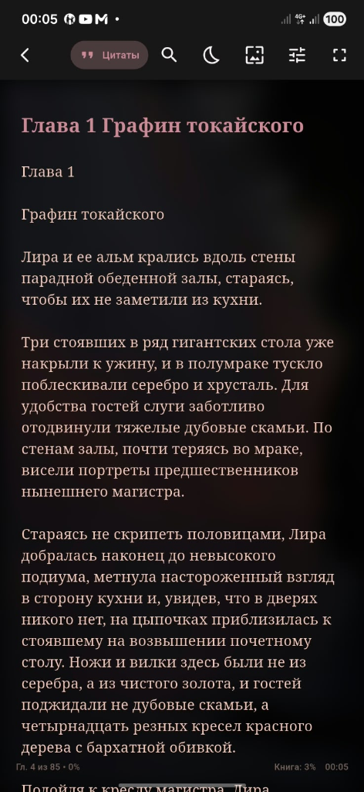
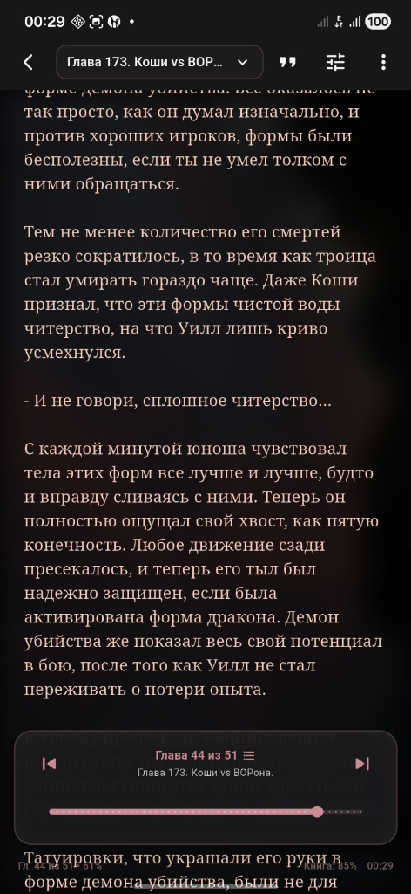
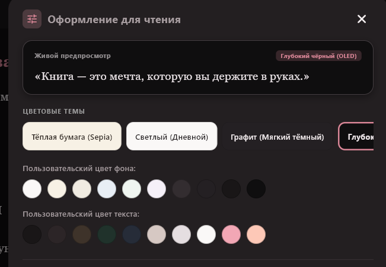

# 📖 LiReader

  
  &nbsp;&nbsp;&nbsp;&nbsp;
  
  &nbsp;&nbsp;&nbsp;&nbsp;
  

**Современная, быстрая и эстетичная читалка для Android**  
*Поддержка EPUB, FB2, TXT, Markdown и PDF, озвучка книг голосом (TTS), дизайнерские карточки цитат, живые обои и автообновления напрямую с GitHub.*

[**⬇️ Скачать последний релиз (APK)**](https://github.com/lubovoladuska/LiReader/releases/latest) • [**💬 Написать автору**](https://wa.me/77087153537)

---

## ✨ Ключевые возможности

### 🎧 Озвучка книг голосом (Text-to-Speech / TTS)
- **Слушайте книги в любом месте:** за рулём, на прогулке или перед сном.
- **Мини-плеер:** компактная плавающая панель с паузой, перемоткой по абзацам и регулировкой скорости от 0.75x до 2.0x.
- **Синхронная подсветка и автоскролл:** читаемый абзац мягко выделяется цветом, а страница плавно прокручивается вслед за голосом.
- **Фоновое воспроизведение:** работает при выключенном экране телефона и переходит к следующей главе автоматически.

### 🖼️ Генератор карточек цитат (Quote Cards)
- **Мгновенное превращение цитаты в открытку:** выделите любой фрагмент текста и нажмите кнопку цитаты.
- **4 авторских стиля:** «Тёмный минимал», «Книжная бумага», «Обои читалки с блюром» и «Ночной градиент».
- **Два формата:** квадрат 1:1 для постов в Telegram/VK и вертикальный 9:16 для Stories и статусов WhatsApp.
- Экспорт в высоком разрешении прямо в мессенджеры или сохранение в галерею.

### 📚 Все форматы в одном приложении
- **EPUB** — с оглавлением, разметкой глав, стилями и иллюстрациями.
- **FB2** — полная поддержка книг русскоязычных библиотек, кодировки Windows-1251 (CP1251), архивов `.fb2.zip` и автоисправление поврежденной XML-разметки.
- **TXT / Markdown** — мгновенное открытие любых текстовых заметок и документов.
- **PDF** — просмотр с плавным масштабированием и поддержкой жестов.

### 🎨 Кастомизация и атмосфера («Фон и Обои»)
- Установка любых собственных фотографий и артов на фон чтения.
- Ползунки затемнения (Dim), размытия (Blur) и тонирования (Tint) в реальном времени.
- Готовые цветовые пресеты: светлая, тёплая бумага (сепия), графит и глубокий черный (AMOLED Black).
- Тонкая настройка типографики: шрифт, размер, межстрочный интервал, отступы и выравнивание текста.

### ⚡ Погружение в чтение (One-Tap Fullscreen)
- Одиночный мягкий тап по экрану плавно скрывает меню и системные панели, погружая в чистый текст без рывков.
- Повторный одиночный тап плавно возвращает элементы управления и навигацию по главам.

### 📊 Честная и точная статистика чтения
- Умный подсчет времени и прочитанных страниц без галлюцинаций таймера.
- Слова фиксируются строго при дочитывании главы (100%) без повторных накруток.
- Детектор бездействия (>90 секунд паузы останавливают таймер).

### 🔄 Встроенные автообновления с GitHub (OTA)
- При запуске приложение проверяет наличие свежей версии на GitHub Releases.
- Фоновая загрузка APK с отображением **процентов, объёма и скорости** в системных уведомлениях Android.
- Автоматический запуск системного установщика сразу по окончании загрузки.

### 💾 Резервное копирование и сохранность данных
- Полный экспорт и импорт библиотеки, полок, прочитанных глав, цитат и пользовательских обоев в один JSON-файл.
- Защита от потери данных при смене телефона или переустановке системы.

---

## 🚀 Установка

1. Перейдите в раздел [**Releases**](https://github.com/lubovoladuska/LiReader/releases).
2. Скачайте свежий файл `LiReader-vX.X.X-release.apk`.
3. Откройте файл на Android-устройстве и подтвердите установку.
4. Все последующие обновления приложение будет находить и предлагать установить автоматически!

---

## 🛠 Технологический стек

- **Фреймворк:** Flutter (Dart 3.x)
- **Синтез речи:** `flutter_tts` (системный TTS движок)
- **Экспорт цитат:** `share_plus`, `path_provider`
- **База данных:** SQLite (`sqflite`)
- **Управление состоянием:** `provider`
- **Парсеры книг:** `archive`, `xml`, `epub_view`, `pdfrx`
- **Загрузка и сеть:** `dio`
- **Уведомления:** `flutter_local_notifications`
- **Установщик пакетов:** `open_filex`

---

## 💬 Обратная связь и контакты

Есть идея, предложение или нашли баг? Напишите автору напрямую:
- 📱 **WhatsApp:** [+7 708 715 35 37](https://wa.me/77087153537?text=%D0%97%D0%B4%D1%80%D0%B0%D0%B2%D1%81%D1%82%D0%B2%D1%83%D0%B9%D1%82%D0%B5!%20%D0%AF%20%D0%BF%D0%BE%D0%BB%D1%8C%D0%B7%D1%83%D1%8E%D1%81%D1%8C%20%D0%B2%D0%B0%D1%88%D0%B8%D0%BC%20%D0%BF%D1%80%D0%B8%D0%BB%D0%BE%D0%B6%D0%B5%D0%BD%D0%B8%D0%B5%D0%BC%20LiReader...)
- 🐙 **GitHub Issues:** [Создать тикет](https://github.com/lubovoladuska/LiReader/issues)

---

Сделано с любовью для комфортного чтения ❤️

